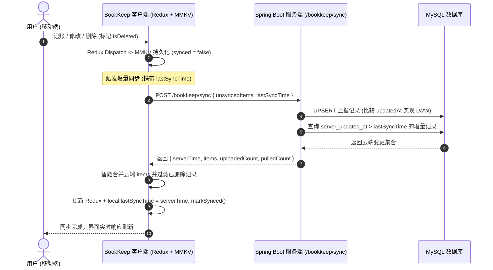

<div align="center">

# 📖 三金记账 (BookKeep)

<p align="center">
  <strong>基于 React Native、Redux Toolkit、React Navigation 7 与 react-native-mmkv 现代化主流架构的记账应用</strong>
</p>

[](https://reactnative.dev)
[](https://reactnavigation.org)
[](https://redux-toolkit.js.org)
[](https://github.com/mrousavy/react-native-mmkv)
[](https://www.typescriptlang.org)
[](https://spring.io/projects/spring-boot)
[](./LICENSE)
[](https://github.com/Akiha678/BookKeep/pulls)

<p align="center">
  <a href="./README.md">简体中文</a> •
  <a href="./README_EN.md">English</a>
</p>

</div>

---

## 📌 项目简介

**三金记账 (BookKeep)** 是一款秉承**离线优先（Offline-First）**与**高性能响应**理念的现代化移动记账应用。全新架构基于业界主流的前端技术栈（**Redux Toolkit + React Navigation 7 + react-native-mmkv**）重构，采用模块化 Feature-First 目录规范。

界面遵循清爽明亮的天空蓝（Sky Blue）现代设计语言，原生集成多端双向增量同步，无缝对接 **Spring Boot** 云端后端服务；在离线状态下依托 MMKV 毫秒级写入，联网后自动静默增量同步，保障账目永不丢失。

<div align="center">
  
</div>

---

## 🚀 现代化主流架构重构亮点

- ⚡ **Redux Toolkit 规范状态管理**：
  - 核心状态拆分为 `bookkeepSlice`、`authSlice`、`syncSlice` 独立切片；
  - 统一通过类型化 Hooks (`useAppDispatch`, `useAppSelector`) 获取与派发状态，逻辑完全与 UI 解耦；
  - 告别传统脏乱的本地 State 传递，所有账目变动、筛选状态与全局弹窗集中可控。
- 🧭 **React Navigation 7 现代化路由调度**：
  - 基于 `@react-navigation/native`、`@react-navigation/bottom-tabs` 构建原生级页面堆栈；
  - 采用自定义 BottomTabBar 实现符合主流交互的底部导航（明细、凸起圆形加号记账大按钮、我的）；
  - 统一导航类型系统 (`RootTabParamList` 与 `RootStackParamList`)，提供端到端类型安全。
- 🏎️ **react-native-mmkv 极速本地持久化**：
  - 替换低效 AsyncStorage，依托 Tencent C++ MMKV 原生模块实现百倍级读写性能；
  - Redux 状态与 MMKV 存储实时透明双向映射，冷启动秒级还原账本与用户状态；
  - 完善的内存兜底设计，确保在测试与降级环境下零崩溃运行。
- 🧩 **高内聚低耦合 Feature-First 目录划分**：
  - 模块按业务独立划分 (`features/bookkeep`, `features/auth`, `features/mine`)；
  - 下沉通用基础设施层 (`shared/storage`, `shared/theme`, `shared/types`, `shared/utils`)；
  - 代码职责明晰，可维护性与可测试性达到企业级标准。

---

## ✨ 核心功能特性

- 🎨 **清爽天空蓝设计系统**：沉浸式卡片流与层级阴影，搭配温润的天空蓝主色调。
- 📱 **精致现代化交互与黄金比例布局**：
  - **1/4 屏幕高密度 HeaderCard**：整合 AppBar（品牌与子Tab）、日期/收入/支出单行看板、全部明细/支出/收入单行过滤；
  - **明细内双模平滑切换**：在明细页面内原生支持「明细流水」与「图表统计」秒级平滑切换；
  - **底部经典三段式导航**：左侧「明细」、右侧「我的」，中间凸起天空蓝加号「＋」快捷记账大按钮。
- ⚡ **闪电敏捷记账**：快捷选择支出/收入类型与丰富生活消费类别（餐饮、交通、购物、日用、工资等），支持预设快捷备注标签与即时收支计算。
- 📊 **多维收支图表统计**：
  - 按月自动汇总总结余、总支出与总收入；
  - 智能分类排行榜与占比进度条，精准洞察财务开支分布；
  - 明细列表按自然日自动分组展示，清晰呈现每日流水。
- ☁️ **离线优先 & 云端双向增量同步**：
  - 核心存储依托 MMKV 支持离线极速读写，无网络也能流畅记账；
  - 接入 Spring Boot 云端后端，基于 `server_updated_at` 时间戳实现毫秒级增量拉取；
  - 内置 **LWW (Last-Write-Wins)** 冲突解决算法与 **软删除墓碑（Tombstones）** 机制，彻底避免分布式离线数据被云端旧记录“复活”的常见同步缺陷。
- 🔐 **完备的账号鉴权体系与沉浸式个人中心**：
  - **主流现代认证界面**：个人中心未登录时原生呈现主流 App 质感界面，默认主打邮箱验证码快速注册，拒绝粗糙弹窗，体验流畅自然；
  - **邮箱验证码注册**：支持邮箱输入 4 位数字验证码校验并直接开户登录；
  - **账号/邮箱登录**：支持已注册的用户名或邮箱配合密码快速登录；
  - **手机免密快捷登录**：支持手机号短信验证码秒级登录，新手机号自动注册；
  - **会话与云端控制**：支持安全登出，登录后自动开启云端多端实时双向增量同步。
- 💾 **本地数据自由备份与迁移**：
  - 支持将全量本地记账数据导出为标准化 JSON 字符串备份；
  - 支持导入外部 JSON 备份进行智能数据合并，数据所有权完全掌握在用户手中。

---

## 🏗️ 架构与同步设计

### 双向增量同步原理



---

## 🛠️ 技术栈

### 客户端 (Client)
- **核心框架**：[React Native 0.87.1](https://reactnative.dev)
- **运行时环境**：React 19
- **状态管理**：[@reduxjs/toolkit 2.x](https://redux-toolkit.js.org) + [react-redux 9.x](https://react-redux.js.org)
- **导航路由**：[@react-navigation/native 7.x](https://reactnavigation.org) + Bottom Tabs + Native Stack
- **本地持久化**：[react-native-mmkv 4.x](https://github.com/mrousavy/react-native-mmkv)
- **安全边距**：`react-native-safe-area-context 5.x`
- **原生转场优化**：`react-native-screens 4.x`
- **代码规范与测试**：TypeScript 5.x / ESLint / Prettier / Jest

### 服务端 (Server)
- **后端架构**：Java 21 / [Spring Boot 3.x](https://spring.io/projects/spring-boot)
- **数据库**：MySQL 8.0（配合 Flyway 版本迁移）
- **安全与认证**：Spring Security, BCrypt, 32 字节高熵 Bearer Token 机制

---

## 📁 目录结构

```text
BookKeep/
├── android/                 # Android 原生工程 (应用名: 三金记账, 多密度 App 图标)
├── ios/                     # iOS 原生工程与 Podfile (Display Name: 三金记账, AppIcon)
├── assets/                  # 静态资源目录 (logo.png)
├── docs/image/              # 文档图元资产 (logo.png, screen.png)
├── __tests__/               # Jest 自动化测试套件
│   ├── App.test.tsx         # 根组件挂载与导航渲染测试
│   └── bookkeepSlice.test.ts# Redux 状态切片业务逻辑单测
├── src/
│   ├── app/                 # 应用核心入口
│   │   └── App.tsx          # 唯一应用根组件 (Redux Provider, Safe Area, NavigationContainer, GlobalModals)
│   ├── navigation/          # 路由配置层
│   │   ├── RootNavigator.tsx# React Navigation 7 底部 Tab 与自定义凸起加号栏
│   │   └── types.ts         # Navigation ParamList 路由类型定义
│   ├── stores/              # Redux 状态中心
│   │   ├── hooks.ts         # useAppDispatch & useAppSelector 类型化 Hooks
│   │   ├── index.ts         # configureStore 全局 Store 配置
│   │   └── slices/          # 业务状态切片 (bookkeepSlice, authSlice, syncSlice)
│   ├── features/            # Feature-First 业务功能模块
│   │   ├── bookkeep/        # 记账主模块
│   │   │   ├── components/  # HeaderCard, TransactionItem, AddTransactionModal, StatisticsView
│   │   │   ├── screens/     # BillsScreen (明细与图表)
│   │   │   └── services/    # cloudSync.ts (云端双向增量同步)
│   │   ├── auth/            # 鉴权模块
│   │   │   ├── components/  # AuthModal (登录/验证码模态框)
│   │   │   └── services/    # authService.ts (登录/邮箱/短信/登出接口)
│   │   └── mine/            # 个人中心模块
│   │       ├── components/  # CloudSyncModal (云同步设置模态框)
│   │       └── screens/     # MineScreen (个人中心、云同步状态、备份恢复与设置)
│   ├── shared/              # 全局下沉共享层
│   │   ├── constants/       # categories.ts (收支分类元数据)
│   │   ├── storage/         # mmkvStorage.ts (MMKV 极速持久化服务)
│   │   ├── theme/           # colors.ts (天空蓝设计色彩体系)
│   │   ├── types/           # bookkeep.ts (通用业务数据结构定义)
│   │   └── utils/           # format.ts (货币、自然日分组、月度汇总算法)
│   └── services/            # 兼容导出层 (storage.ts, cloudSync.ts, authService.ts)
├── index.js                 # React Native 入口文件 (注册 ./src/app/App)
├── jest.config.js           # Jest 测试配置
├── jest.setup.js            # Jest 运行时 Mocks (MMKV, Screens, Safe Area)
└── package.json             # 依赖声明与运行脚本
```

---

## 🚀 快速上手

### 1. 环境准备
确保本地开发机已安装以下环境：
- **Node.js** >= 22.11.0
- **JDK** >= 17（推荐 JDK 21）
- **Android Studio** 与 Android SDK（已配置 `ANDROID_HOME` 环境变量）
- （可选）macOS + Xcode（用于运行 iOS 版本）

### 2. 克隆与安装依赖

```bash
# 克隆仓库
git clone https://github.com/Akiha678/BookKeep.git
cd BookKeep

# 安装前端依赖
npm install
```

### 3. 配置服务端地址
默认客户端服务端同步地址为局域网 IP（`http://10.10.1.9:8080`）。如需在本地模拟器运行并直连本机服务：
- Android 官方模拟器默认直连主机 IP 为：`http://10.0.2.2:8080`；
- 真机调试请确保手机与电脑在同一 Wi-Fi 局域网下，并在 App 的【个人中心 - 服务端接口高级配置】中输入开发机局域网 IP。

### 4. 运行应用

```bash
# 启动 Metro 打包服务
npm start

# 新开终端运行 Android 端
npm run android

# 运行 iOS 端 (仅 macOS)
npm run ios
```

---

## 💻 常用脚本

| 命令 | 说明 |
| :--- | :--- |
| `npm start` | 启动 Metro Bundler 增量打包服务 |
| `npm run android` | 编译并安装运行 Android Debug 版本 |
| `npm run ios` | 编译并在模拟器运行 iOS 版本 |
| `npm run lint` | 执行 ESLint 严格代码规范检查 (0 errors) |
| `npm test` | 执行 Jest 自动化单元测试 (全通过) |

---

## 🗺️ 后续迭代路线

- [x] 基于 Redux Toolkit、React Navigation 7、react-native-mmkv 全面重构
- [x] 完整的离线记账与分类统计
- [x] 基于 Spring Boot 的多设备增量双向同步
- [x] 账号密码、手机免密与邮箱验证码注册体系
- [x] 本地标准化 JSON 备份导出与合并恢复
- [ ] 预算超支告警与月度预算设定
- [ ] 自定义账本与家庭/情侣多账本共享
- [ ] 更多导出格式支持（Excel / CSV 报表）

---

## 🤝 贡献与参与

欢迎对 BookKeep 提供任何形式的反馈与代码贡献！
1. Fork 本项目仓库
2. 新建特性分支 (`git checkout -b feat/your-feature`)
3. 提交代码变更 (`git commit -m 'feat: add amazing feature'`)
4. 推送至远程分支 (`git push origin feat/your-feature`)
5. 创建 Pull Request

---

## 📄 开源许可证

本项目基于 [MIT License](./LICENSE) 协议开源。
欢迎自由学习、使用与衍生开发！