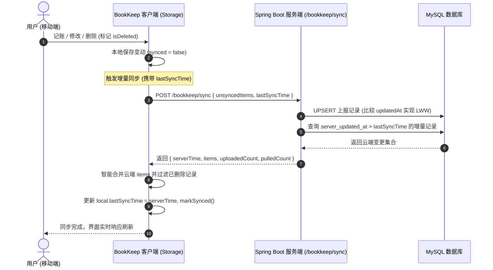

<div align="center">

# 📖 BookKeep 记账本

<p align="center">
  <strong>一款基于 React Native 与 TypeScript 构建的轻量、美观、支持云端双向增量同步的移动记账应用</strong>
</p>

[](https://reactnative.dev)
[](https://www.typescriptlang.org)
[](https://spring.io/projects/spring-boot)
[](https://reactnative.dev)
[](./LICENSE)
[](https://github.com/Akiha678/BookKeep/pulls)

<p align="center">
  <a href="./README.md">简体中文</a> •
  <a href="./README_EN.md">English</a>
</p>

</div>

---

## 📌 项目简介

**BookKeep** 是一款秉承**离线优先（Offline-First）**理念的个人财务记账应用。界面采用清爽明亮的天空蓝（Sky Blue）现代设计语言，专注于提供极简流畅的记账交互体验。

应用原生支持多端双向增量同步，无缝对接 **Spring Boot** 后端数据库；在离线或无网环境下依然可以无障碍记账，待网络连接恢复后自动同步至云端，确保在更换设备或重装应用时数据永不丢失。

<div align="center">
  
</div>

---

## ✨ 核心特性

- 🎨 **清爽天空蓝设计**：符合现代审美的 Sky Blue 色彩体系与卡片流设计，告别繁冗杂乱的界面。
- ⚡ **闪电敏捷记账**：快捷选择支出/收入类型与丰富生活消费类别（餐饮、交通、购物、日用、工资等），支持预设快捷备注标签与即时收支计算。
- 📊 **多维收支图表统计**：
  - 按月自动汇总总结余、总支出与总收入；
  - 智能分类排行榜与占比进度条，精准洞察财务开支分布；
  - 明细列表按自然日自动分组展示，清晰呈现每日流水。
- ☁️ **离线优先 & 云端双向增量同步**：
  - 核心存储支持离线快速读写，无网络也能流畅记账；
  - 接入 Spring Boot 云端后端，基于 `server_updated_at` 时间戳实现毫秒级增量拉取；
  - 内置 **LWW (Last-Write-Wins)** 冲突解决算法与 **软删除墓碑（Tombstones）** 机制，彻底避免分布式离线数据被云端旧记录“复活”的常见同步缺陷。
- 🔐 **完备的账号鉴权体系**：
  - **账号/邮箱登录**：支持用户名或邮箱配合密码快速登录；
  - **手机免密快捷登录**：支持手机号短信验证码登录，未注册手机号自动完成注册；
  - **邮箱验证码注册**：支持邮箱验证码校验与新账号注册；
  - **会话安全管理**：随时一键安全退出登录并自动吊销会话令牌。
- 💾 **本地数据自由备份与迁移**：
  - 支持将全量本地记账数据导出为标准化 JSON 字符串备份；
  - 支持导入外部 JSON 备份进行智能数据合并，数据所有权完全掌握在用户手中。

---

## 🏗️ 架构与同步设计

### 双向增量同步原理



---

## 🛠️ 技术栈

### 客户端 (Client)
- **核心框架**：[React Native 0.87.1](https://reactnative.dev)
- **运行时环境**：React 19
- **编程语言**：[TypeScript 5.x](https://www.typescriptlang.org)
- **安全区域与布局**：`react-native-safe-area-context`
- **代码规范与测试**：ESLint, Prettier, Jest

### 服务端 (Server)
- **后端架构**：Java 21 / [Spring Boot 3.x](https://spring.io/projects/spring-boot)
- **数据库**：MySQL 8.0（配合 Flyway 版本迁移）
- **安全与认证**：Spring Security, BCrypt, 32 字节高熵 Bearer Token 机制

---

## 📁 目录结构

```text
BookKeep/
├── android/                 # Android 原生工程与 Gradle 配置
├── ios/                     # iOS 原生工程与 Podfile
├── src/
│   ├── app/
│   │   └── App.tsx          # 客户端主页面与状态调度
│   ├── components/          # 核心 UI 组件
│   │   ├── AddTransactionModal.tsx  # 记一笔新增/编辑弹窗
│   │   ├── AuthModal.tsx            # 登录/手机免密/邮箱注册模态框
│   │   ├── CloudSyncModal.tsx       # 用户中心与云端增量同步中心
│   │   ├── HeaderCard.tsx           # 顶部月度汇总与云同步徽标卡片
│   │   ├── StatisticsView.tsx       # 统计图表与类别洞察视图
│   │   └── TransactionItem.tsx      # 单笔收支流水列表项组件
│   ├── constants/           # 预设收支分类配置
│   ├── services/            # 核心业务服务层
│   │   ├── authService.ts   # 用户认证服务 (登录/注册/验证码/登出)
│   │   ├── cloudSync.ts     # 云端双向增量同步服务
│   │   └── storage.ts       # 本地离线存储引擎与事件通知
│   ├── theme/               # 设计规范 (色彩系统与常用变量)
│   ├── type/                # TypeScript 统一数据结构定义
│   └── utils/               # 日期格式化与金额计算工具
├── App.tsx                  # 根组件 (安全边距 Provider 封装)
├── index.js                 # React Native 入口文件
├── screen.png               # 应用界面预览图
└── package.json             # 依赖声明与脚本
```

---

## 🚀 快速上手

### 1. 环境准备
确保本地开发机已安装以下环境：
- **Node.js** >= 22.11.0
- **JDK** >= 17（推荐 JDK 21）
- **Android Studio** 与 Android SDK（已配置 `ANDROID_HOME` 环境变量）
- （可选）macOS + Xcode（用于运行 iOS 版本）

### 2. 克隆与安装依赖

```bash
# 克隆仓库
git clone https://github.com/Akiha678/BookKeep.git
cd BookKeep

# 安装前端依赖
npm install
```

### 3. 配置服务端地址
默认客户端服务端同步地址为局域网 IP（`http://10.10.1.9:8080`）。如需在本地模拟器运行并直连本机服务：
- Android 官方模拟器默认直连主机 IP 为：`http://10.0.2.2:8080`；
- 真机调试请确保手机与电脑在同一 Wi-Fi 局域网下，并在 App 的【云端同步中心 - 服务端接口配置】中输入开发机局域网 IP。

### 4. 运行应用

```bash
# 启动 Metro 打包服务
npm start

# 新开终端运行 Android 端
npm run android

# 运行 iOS 端 (仅 macOS)
npm run ios
```

---

## 💻 常用脚本

| 命令 | 说明 |
| :--- | :--- |
| `npm start` | 启动 Metro Bundler 增量打包服务 |
| `npm run android` | 编译并安装运行 Android Debug 版本 |
| `npm run ios` | 编译并在模拟器运行 iOS 版本 |
| `npm run lint` | 执行 ESLint 严格代码规范检查 |
| `npm test` | 执行 Jest 单元测试 |

---

## 🗺️ 后续迭代路线

- [x] 完整的离线记账与分类统计
- [x] 基于 Spring Boot 的多设备增量双向同步
- [x] 账号密码、手机免密与邮箱验证码注册体系
- [x] 本地标准化 JSON 备份导出与合并恢复
- [ ] 预算超支告警与月度预算设定
- [ ] 自定义账本与家庭/情侣多账本共享
- [ ] 更多导出格式支持（Excel / CSV 报表）

---

## 🤝 贡献与参与

欢迎对 BookKeep 提供任何形式的反馈与代码贡献！
1. Fork 本项目仓库
2. 新建特性分支 (`git checkout -b feat/your-feature`)
3. 提交代码变更 (`git commit -m 'feat: add amazing feature'`)
4. 推送至远程分支 (`git push origin feat/your-feature`)
5. 创建 Pull Request

---

## 📄 开源许可证

本项目基于 [MIT License](./LICENSE) 协议开源。
欢迎自由学习、使用与衍生开发！