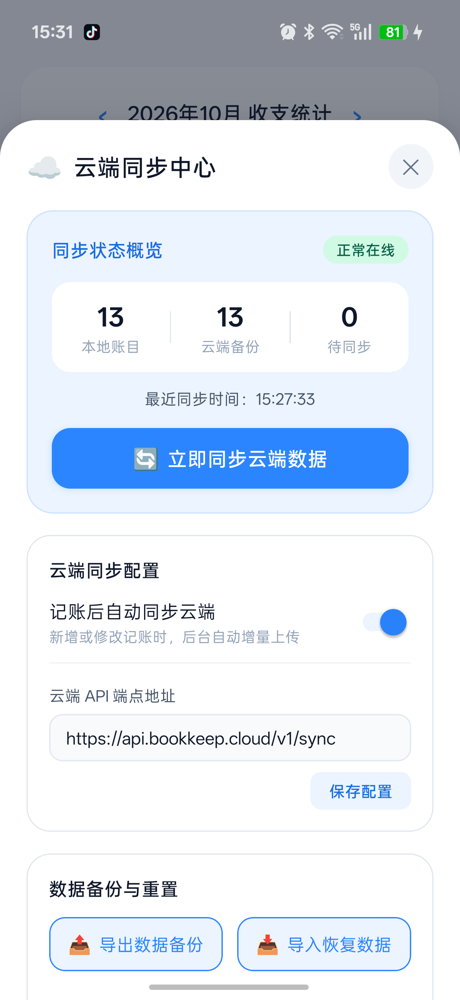

<div align="center">

# 📖 Sanjin BookKeep (三金记账)

<p align="center">
  <strong>A modern personal finance & bookkeeping application built with React Native, Redux Toolkit, React Navigation 7, and react-native-mmkv.</strong>
</p>

[](https://reactnative.dev)
[](https://reactnavigation.org)
[](https://redux-toolkit.js.org)
[](https://github.com/mrousavy/react-native-mmkv)
[](https://www.typescriptlang.org)
[](https://spring.io/projects/spring-boot)
[](./LICENSE)
[](https://github.com/Akiha678/BookKeep/pulls)

<p align="center">
  <a href="./README.md">简体中文</a> •
  <a href="./README_EN.md">English</a>
</p>

</div>

---

## 📌 Introduction

**BookKeep** is a personal finance and expense tracking mobile application crafted with an **Offline-First** and **High-Performance** philosophy. The app has been thoroughly reconstructed on top of the industry-standard modern stack: **Redux Toolkit + React Navigation 7 + react-native-mmkv**, following a modular Feature-First directory convention.

Designed with a clean, vibrant Sky Blue visual aesthetic, it natively supports seamless bidirectional incremental synchronization with a **Spring Boot** backend database. Transactions can be recorded smoothly even without network connectivity and will automatically synchronize when reconnected, ensuring zero data loss across device switches or app re-installations.

<div align="center">
  
</div>

---

## 🚀 Architectural Reconstruction Highlights

- ⚡ **Redux Toolkit Standardized State Management**:
  - State cleanly decoupled into granular slices: `bookkeepSlice`, `authSlice`, and `syncSlice`;
  - Type-safe hooks (`useAppDispatch`, `useAppSelector`) for state access and mutations;
  - Zero messy local state passing across screens, with centralized transactions, filter conditions, and global modal state.
- 🧭 **React Navigation 7 Modern Routing Architecture**:
  - Leverages `@react-navigation/native` and `@react-navigation/bottom-tabs` for native-grade stack navigation;
  - Custom BottomTabBar rendering an ergonomic tri-section navigation (Bills, prominent elevated "+" button, Mine);
  - Unified navigation type registry (`RootTabParamList` & `RootStackParamList`) providing end-to-end type safety.
- 🏎️ **react-native-mmkv Blazing Fast Storage Engine**:
  - Replaces slow legacy AsyncStorage with Tencent C++ MMKV native modules for orders-of-magnitude faster I/O;
  - Synchronous two-way mapping between Redux state and local key-value storage;
  - Robust in-memory fallback mechanism ensuring zero crashes during testing or unlinked environments.
- 🧩 **High Cohesion, Low Coupling Feature-First Structure**:
  - Modular directory organization (`features/bookkeep`, `features/auth`, `features/mine`);
  - Shared infrastructure layer (`shared/storage`, `shared/theme`, `shared/types`, `shared/utils`);
  - High enterprise-grade maintainability, cleanliness, and testability.

---

## ✨ Key Features

- 🎨 **Modern Sky Blue Design System**: Vibrant yet minimalist cards, subtle gradients, and intuitive micro-interactions.
- 📱 **Refined Modern UX & 1/4 Height Golden Ratio Header**:
  - **1/4 Screen Height HeaderCard**: Compact three-tier layout (AppBar with sub-tabs, Date/Income/Expense in a single row, and All/Expense/Income filter row);
  - **In-Bills Dual Tab Switching**: Seamlessly toggle between "Bills Flow" and "Analytics Chart" directly within the Bills screen;
  - **Classic Tri-Section Bottom Navigation**: Clean "Bills" (Left), "Mine" (Right), with a prominent floating sky-blue plus "＋" center button.
- ⚡ **Lightning Fast Expense Recording**: Seamlessly switch between expense and income, with comprehensive lifestyle categories (Dining, Transit, Shopping, Groceries, Salary, etc.) and instant balance calculation.
- 📊 **Insightful Statistics & Visual Analytics**:
  - Automatically calculates monthly net balance, total income, and total expenditure;
  - Category percentage breakdown progress bars and ranking lists for deep financial insights;
  - Daily timeline groups displaying individual transactions and daily balances.
- ☁️ **Offline-First & Bidirectional Cloud Synchronization**:
  - High-performance MMKV storage engine ensuring immediate read/write responsiveness offline;
  - Backed by a Spring Boot cloud API, performing sub-second incremental pulls based on `server_updated_at` timestamps;
  - Built-in **LWW (Last-Write-Wins)** conflict resolution and **Tombstone Soft-Delete** mechanics to prevent resurrected records across devices.
- 🔐 **Modern Minimalist Multi-Step Authentication & User Center**:
  - **Sleek Minimalist Multi-Step UI (Modern Blackbox-Style)**: Pristine white aesthetic, prominent bold typography, and single-line underlined inputs replacing bulky forms;
  - **Step 1 - Email Code Request Screen**: Defaults to "Verification Code Login" with single-line email input and dynamic "Get Verification Code" button; bottom-left switch to "Password Login", bottom-right "Account Recovery";
  - **Step 2 - 4-Box Verification Code Screen**: Smooth transition upon code dispatch showing destination email; 4 individual square boxes with auto-focus, cursor tracking, and instant auto-submit upon entering 4 digits; includes 60s countdown resend button;
  - **Password Login Mode**: Seamless toggle to "Password Login" with single-line email/account and password inputs (with eye visibility toggle), "Log In" action button, bottom-left "Code Login" toggle, and quick test admin autofill;
  - **Compliance & Branding**: Integrated Apple / WeChat sign-in options, circular agreement checkbox ("Terms of Service" & "Privacy Policy"), and official BookKeep branding;
  - **User Center Integration**: Unauthenticated state in the "Mine" tab gracefully displays offline bookkeep status with one-tap modal trigger, followed by automatic bidirectional cloud synchronization upon login.
- 💾 **Data Portability & One-Click Backup**:
  - Export all transaction records to standardized JSON backup files;
  - Import and merge previous JSON backups effortlessly, putting data ownership entirely in your hands.

---

## 🏗️ Architecture & Cloud Sync Workflow


---

## 🛠️ Tech Stack

### Client Side
- **Framework**: [React Native 0.87.1](https://reactnative.dev)
- **Runtime**: React 19
- **State Management**: [@reduxjs/toolkit 2.x](https://redux-toolkit.js.org) + [react-redux 9.x](https://react-redux.js.org)
- **Routing & Navigation**: [@react-navigation/native 7.x](https://reactnavigation.org) + Bottom Tabs + Native Stack
- **Local Persistence**: [react-native-mmkv 4.x](https://github.com/mrousavy/react-native-mmkv) + [react-native-nitro-modules](https://github.com/mrousavy/nitro) (C++ Nitro high-performance JNI runtime)
- **Safe Area**: `react-native-safe-area-context 5.x`
- **Native Screens**: `react-native-screens 4.x`
- **Code Standards & Testing**: TypeScript 5.x / ESLint / Prettier / Jest

### Server Side
- **Architecture**: Java 21 / [Spring Boot 3.x](https://spring.io/projects/spring-boot)
- **Database**: MySQL 8.0 (with Flyway database migrations)
- **Security**: Spring Security, BCrypt, 32-byte high-entropy Bearer Token session management

---

## 📁 Directory Structure

```text
BookKeep/
├── android/                 # Android native project (App Name: 三金记账, multi-density icons)
├── ios/                     # iOS native project & Podfile (Display Name: 三金记账, AppIcon)
├── assets/                  # Static assets directory (logo.png)
├── docs/image/              # Documentation assets (logo.png, screen.png)
├── __tests__/               # Jest automated test suites
│   ├── App.test.tsx         # Root component mount & navigation rendering test
│   └── bookkeepSlice.test.ts# Redux slice business logic unit tests
├── src/
│   ├── app/                 # Application root entry
│   │   └── App.tsx          # Sole application root component (Redux Provider, Safe Area, NavigationContainer, GlobalModals)
│   ├── navigation/          # Navigation layer
│   │   ├── RootNavigator.tsx# React Navigation 7 bottom tab navigator with custom floating add button
│   │   └── types.ts         # Navigation ParamList route type definitions
│   ├── stores/              # Redux central store
│   │   ├── hooks.ts         # useAppDispatch & useAppSelector typed hooks
│   │   ├── index.ts         # configureStore global store setup
│   │   └── slices/          # Business state slices (bookkeepSlice, authSlice, syncSlice)
│   ├── features/            # Feature-First business modules
│   │   ├── bookkeep/        # Core bookkeeping module
│   │   │   ├── components/  # HeaderCard, TransactionItem, AddTransactionModal, StatisticsView
│   │   │   ├── screens/     # BillsScreen (Bills flow & charts)
│   │   │   └── services/    # cloudSync.ts (Bidirectional cloud sync)
│   │   ├── auth/            # Authentication module
│   │   │   ├── components/  # AuthModal (Login & verification code modal)
│   │   │   └── services/    # authService.ts (Login/register/SMS/logout API)
│   │   └── mine/            # User center module
│   │       ├── components/  # CloudSyncModal (Cloud sync configuration modal)
│   │       └── screens/     # MineScreen (Profile, sync status, backup & settings)
│   ├── shared/              # Shared infrastructure layer
│   │   ├── constants/       # categories.ts (Category metadata)
│   │   ├── storage/         # mmkvStorage.ts (MMKV ultra-fast storage engine)
│   │   ├── theme/           # colors.ts (Sky Blue theme palette)
│   │   ├── types/           # bookkeep.ts (Unified TypeScript definitions)
│   │   └── utils/           # format.ts (Currency, calendar groups, monthly summary helpers)
│   └── services/            # Backward compatibility exports (storage.ts, cloudSync.ts, authService.ts)
├── index.js                 # React Native bootstrap file (registers ./src/app/App)
├── jest.config.js           # Jest configuration
├── jest.setup.js            # Jest runtime mocks (MMKV, Screens, Safe Area)
└── package.json             # Dependencies and scripts
```

---

## 🚀 Quick Start

### 1. Prerequisites
Ensure the following development tools are installed:
- **Node.js** >= 22.11.0
- **JDK** >= 17 (JDK 21 recommended)
- **Android Studio** & Android SDK (with configured `ANDROID_HOME`)
- (Optional) macOS + Xcode (for running iOS version)

### 2. Clone & Install Dependencies

```bash
# Clone repository
git clone https://github.com/Akiha678/BookKeep.git
cd BookKeep

# Install dependencies
npm install
```

### 3. Server Configuration
The default sync URL points to local LAN (`http://10.10.1.9:8080`). For local emulator testing:
- Android official emulator host loopback address: `http://10.0.2.2:8080`;
- For physical device debugging, connect both device and computer to the same Wi-Fi and configure the IP in **Mine > Advanced Server Configuration**.

### 4. Run Application

```bash
# Start Metro bundler
npm start

# Run Android (separate terminal)
npm run android

# Run iOS (macOS only)
npm run ios
```

---

## 💻 Available Scripts

| Command | Description |
| :--- | :--- |
| `npm start` | Starts Metro Bundler incremental server |
| `npm run android` | Compiles and installs Android Debug app |
| `npm run ios` | Compiles and launches iOS app in Simulator |
| `npm run lint` | Runs ESLint static analysis (0 errors) |
| `npm test` | Runs Jest automated unit tests (All passing) |

---

## 🗺️ Roadmap

- [x] Full architectural reconstruction with Redux Toolkit, React Navigation 7, and react-native-mmkv
- [x] Offline-first expense tracking and categorized analytics
- [x] Bidirectional cloud sync with Spring Boot backend
- [x] Multi-method authentication (Password, SMS OTP, Email verification)
- [x] Standardized JSON backup export and merge restoration
- [ ] Budget limit alerts and monthly expenditure goals
- [ ] Multiple custom ledgers and family/couple shared accounts
- [ ] Export to spreadsheet formats (Excel / CSV)

---

## 🤝 Contributing

Contributions, issues, and feature requests are welcome!
1. Fork this repository
2. Create your feature branch (`git checkout -b feat/your-feature`)
3. Commit your changes (`git commit -m 'feat: add amazing feature'`)
4. Push to the branch (`git push origin feat/your-feature`)
5. Open a Pull Request

---

## 📄 License

This project is licensed under the [MIT License](./LICENSE).
Feel free to learn, use, and build upon it!
