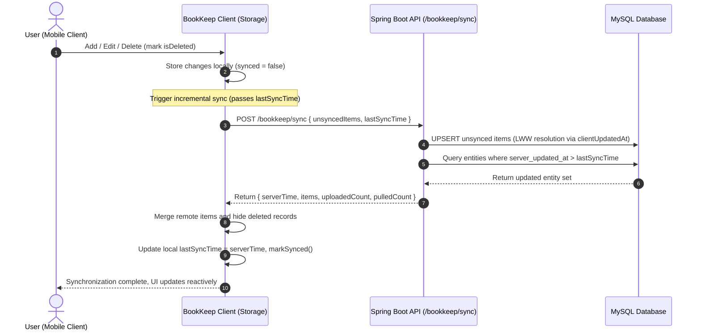

<div align="center">

# 📖 Sanjin BookKeep (三金记账)

<p align="center">
  <strong>A lightweight, elegant, and offline-first mobile bookkeeping app with bidirectional cloud synchronization, built with React Native and TypeScript.</strong>
</p>

[](https://reactnative.dev)
[](https://www.typescriptlang.org)
[](https://spring.io/projects/spring-boot)
[](https://reactnative.dev)
[](./LICENSE)
[](https://github.com/Akiha678/BookKeep/pulls)

<p align="center">
  <a href="./README.md">简体中文</a> •
  <a href="./README_EN.md">English</a>
</p>

</div>

---

## 📌 Introduction

**BookKeep** is a personal finance and expense tracking application crafted with an **Offline-First** philosophy. Designed with a clean, vibrant Sky Blue visual aesthetic, it focuses on offering a delightful, distraction-free recording experience.

The app natively supports seamless bidirectional incremental synchronization with a **Spring Boot** backend database. Transactions can be recorded smoothly even without network connectivity and will automatically synchronize when reconnected, ensuring zero data loss across device switches or app re-installations.

<div align="center">
  
</div>

---

## ✨ Key Features

- 🎨 **Modern Sky Blue Design System**: Vibrant yet minimalist cards, subtle gradients, and intuitive micro-interactions.
- 📱 **Refined Modern UX & 1/4 Height Golden Ratio Header**:
  - **1/4 Screen Height HeaderCard**: Compact three-tier layout (AppBar with sub-tabs, Date/Income/Expense in a single row, and All/Expense/Income filter row);
  - **In-Bills Dual Tab Switching**: Seamlessly toggle between "Bills Flow" and "Analytics Chart" directly within the Bills screen;
  - **Classic Tri-Section Bottom Navigation**: Clean "Bills" (Left), "Mine" (Right), with a prominent floating sky-blue plus "＋" center button.
- ⚡ **Lightning Fast Expense Recording**: Seamlessly switch between expense and income, with comprehensive lifestyle categories (Dining, Transit, Shopping, Groceries, Salary, etc.) and instant balance calculation.
- 📊 **Insightful Statistics & Visual Analytics**:
  - Automatically calculates monthly net balance, total income, and total expenditure;
  - Category percentage breakdown progress bars and ranking lists for deep financial insights;
  - Daily timeline groups displaying individual transactions and daily balances.
- ☁️ **Offline-First & Bidirectional Cloud Synchronization**:
  - High-performance local storage engine ensuring immediate read/write responsiveness offline;
  - Backed by a Spring Boot cloud API, performing sub-second incremental pulls based on `server_updated_at` timestamps;
  - Built-in **LWW (Last-Write-Wins)** conflict resolution and **Tombstone Soft-Delete** mechanics to prevent resurrected records across devices.
- 🔐 **Comprehensive Authentication Suite & Immersive User Center**:
  - **Modern Embedded Auth UI**: Renders an elegant mainstream auth screen directly in the "Mine" tab when unauthenticated, featuring email registration by default;
  - **Email Registration**: Sign up with 4-digit verification code and password;
  - **Account/Email Login**: Sign in with username or email and password;
  - **Passwordless Phone Login**: SMS code login with automatic account registration for new phone numbers;
  - **Session Security**: Revoke active tokens and log out safely at any time.
- 💾 **Data Portability & One-Click Backup**:
  - Export all transaction records to standardized JSON backup files;
  - Import and merge previous JSON backups effortlessly, putting data ownership entirely in your hands.

---

## 🏗️ Architecture & Cloud Sync Workflow



---

## 🛠️ Tech Stack

### Client Side
- **Framework**: [React Native 0.87.1](https://reactnative.dev)
- **Runtime**: React 19
- **Language**: [TypeScript 5.x](https://www.typescriptlang.org)
- **Layout & Safe Area**: `react-native-safe-area-context`
- **Linting & Testing**: ESLint, Prettier, Jest

### Server Side
- **Architecture**: Java 21 / [Spring Boot 3.x](https://spring.io/projects/spring-boot)
- **Database**: MySQL 8.0 (with Flyway database migrations)
- **Security**: Spring Security, BCrypt, 32-byte high-entropy Bearer Token session management

---

## 📁 Directory Structure

```text
BookKeep/
├── android/                 # Android native project (App Name: 三金记账, multi-density icons)
├── ios/                     # iOS native project & Podfile (Display Name: 三金记账, AppIcon)
├── docs/image/logo.png      # Original App Logo asset
├── src/
│   ├── app/
│   │   └── App.tsx          # Main entry screen & state coordination
│   ├── assets/              # Static icon assets (logo.png)
│   ├── components/          # Core reusable UI components
│   │   ├── AddTransactionModal.tsx  # Add / Edit transaction modal
│   │   ├── AuthModal.tsx            # Login, Phone SMS & Email registration modal
│   │   ├── CloudSyncModal.tsx       # Cloud sync dashboard & user center
│   │   ├── HeaderCard.tsx           # 1/4 Screen Height Header (AppBar / Date-Income-Expense / Filter)
│   │   ├── MineView.tsx             # Bottom "Mine" user center & backup view
│   │   ├── StatisticsView.tsx       # Analytics & category breakdown view
│   │   └── TransactionItem.tsx      # Individual transaction row component
│   ├── constants/           # Transaction category definitions
│   ├── services/            # Service layer
│   │   ├── authService.ts   # Authentication service (login/register/sms/logoff)
│   │   ├── cloudSync.ts     # Bidirectional cloud sync service
│   │   └── storage.ts       # Local storage engine & subscriber events
│   ├── theme/               # Design tokens (Colors, Shadows, Constants)
│   ├── type/                # TypeScript type & interface definitions
│   └── utils/               # Date formatting & money calculation helpers
├── App.tsx                  # Root component (SafeAreaProvider wrapper)
├── index.js                 # React Native bootstrap file
├── screen.png               # Application screenshot preview
└── package.json             # Dependencies and scripts
```

---

## 🚀 Getting Started

### 1. Prerequisites
Make sure your development machine has:
- **Node.js** >= 22.11.0
- **JDK** >= 17 (JDK 21 recommended)
- **Android Studio** & Android SDK (with `ANDROID_HOME` configured)
- (Optional) macOS + Xcode (for iOS builds)

### 2. Clone & Install Dependencies

```bash
# Clone repository
git clone https://github.com/Akiha678/BookKeep.git
cd BookKeep

# Install frontend dependencies
npm install
```

### 3. Server Configuration
By default, the client points to the LAN backend at `http://10.10.1.9:8080`.
- If running on the standard **Android Emulator**, the host machine is accessible at `http://10.0.2.2:8080`;
- If testing on a **physical device**, ensure your device and host share the same local Wi-Fi, and configure the IP in **Cloud Sync Center -> Endpoint Configuration**.

### 4. Run the Application

```bash
# Start Metro bundler
npm start

# Run on connected Android device / emulator
npm run android

# Run on iOS simulator (macOS only)
npm run ios
```

---

## 💻 Available Scripts

| Script | Description |
| :--- | :--- |
| `npm start` | Starts the Metro bundler server |
| `npm run android` | Builds and deploys the Android debug APK |
| `npm run ios` | Builds and launches the iOS app on simulator |
| `npm run lint` | Runs ESLint static analysis checks |
| `npm test` | Executes Jest unit test suites |

---

## 🗺️ Roadmap

- [x] Complete offline expense tracking & monthly analytics
- [x] Bidirectional cloud synchronization with Spring Boot & MySQL
- [x] Multi-mode authentication: Password, Phone SMS, and Email registration
- [x] Standardized JSON backup export & restore
- [ ] Monthly budgeting limits & overspending alerts
- [ ] Multi-ledger support & shared family bookkeeping
- [ ] Extended data export formats (CSV / Excel reports)

---

## 🤝 Contributing

Contributions, feature suggestions, and bug reports are welcome!
1. Fork the Project
2. Create your Feature Branch (`git checkout -b feat/AmazingFeature`)
3. Commit your Changes (`git commit -m 'feat: Add some AmazingFeature'`)
4. Push to the Branch (`git push origin feat/AmazingFeature`)
5. Open a Pull Request

---

## 📄 License

Distributed under the [MIT License](./LICENSE). See `LICENSE` for more information.
